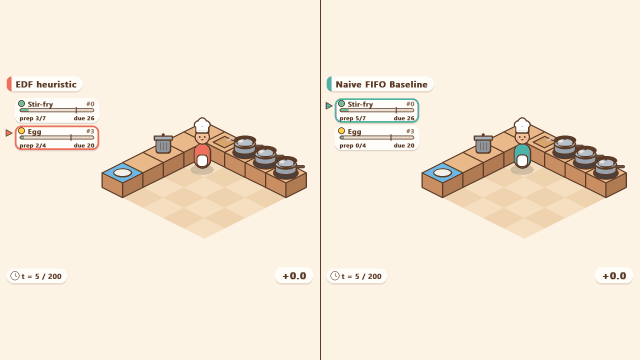

# He(RL)l Kitchen



Proyecto Final — Reinforcement Learning, Universidad del Valle de Guatemala (UVG).

**Fecha de entrega:** 10 de noviembre de 2026

Entrenamos agentes de aprendizaje por refuerzo profundo para manejar una cocina simulada, estocástica y **parcialmente observable (POMDP)**, en la que deben completar órdenes antes de su tiempo límite. Como cualquier chef, el agente solo puede hacer **una acción a la vez** y no ve directamente el estado real de cocción: recibe observaciones ruidosas o incompletas y puede gastar una acción en **probar (taste)** la comida para obtener información más precisa.

Comparamos dos familias de algoritmos:

- **Off-policy:** DQN
- **On-policy:** PPO

El eje del análisis es cómo cada agente equilibra **recolección de información** (probar), **velocidad** (tiempo de entrega) y **calidad** (comida bien cocinada). Este dilema de "informarse más vs. actuar rápido" es análogo al de dominios críticos como el diagnóstico médico, el mantenimiento predictivo o el trading.

## Integrantes

| Nombre          | Carné |
|-----------------|-------|
| Jose Marchena   | 22398 |
| Paula Barillas  | 22764 |

## Estructura de carpetas

```
PROY-RL/
├── README.md               # Descripción del proyecto
├── requirements.txt        # Dependencias de Python con versiones fijas
├── play_sim.py             # Visualizador de replays
├── envs/                   # Ambiente Gymnasium (KitchenEnv)
├── agents/
│   ├── baselines.py        # Políticas aleatoria, FIFO y las de verificación (EDF, triage)
│   └── rl.py               # DQN y PPO: shaping, masking, carga de modelos
├── utils/                  # Seeds
├── experiments/            # Calibración, evaluación, entrenamiento, análisis y replays
│   └── configs/            # Hiperparámetros en YAML (base, tuning y elegidos)
├── notebooks/              # Calibración (00) y baselines (01), con sus conclusiones
├── scripts/run_all.ps1     # Flujo completo con un solo comando
├── viz/                    # Render y reproducción de la cocina en pygame
├── results/
│   ├── models/             # Modelos finales de las 40 corridas
│   ├── runs/               # Logs de cada corrida: config, progreso, evaluaciones
│   ├── figures/            # Gráficas para el reporte
│   ├── tables/             # Tablas de métricas (CSV y Markdown)
│   └── replays/            # Trayectorias para el visualizador
├── tests/                  # Tests unitarios (pytest)
└── docs/
    ├── INFORME.md          # Informe final
    ├── PROMPTS_IA.md       # Registro del uso de IA generativa
    ├── PRESENTACION_outline.md  # Guion de la presentación
    ├── figuras/            # Figuras del informe
    ├── env_design.md       # Diseño del POMDP y metodología
    └── analysis.md         # Análisis y conclusiones
```
