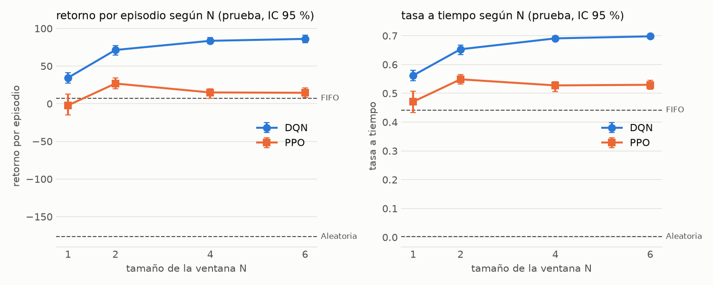
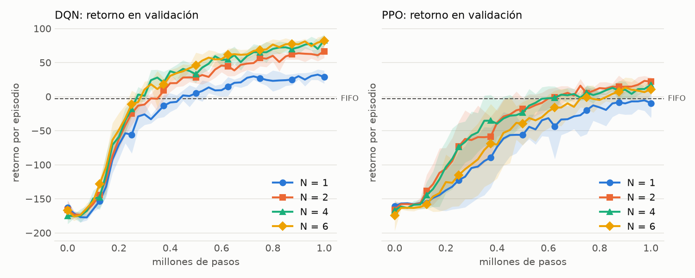
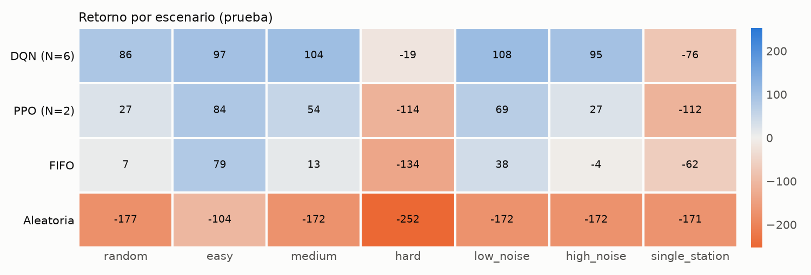

# He(RL)l Kitchen: análisis de resultados

**Proyecto Final — Reinforcement Learning, UVG.** Jose Marchena (22398), Paula Barillas (22764).

Este documento responde la pregunta del proyecto con los resultados de las 40 corridas de `results/runs/grid/`. El diseño y las definiciones de cada métrica están en [`env_design.md`](env_design.md). Todas las tablas y figuras citadas se regeneran con `python -m experiments.analyze`.

## 1. Conclusión

**DQN equilibra mejor la información, la velocidad y la calidad.** Con la ventana N = 6 supera a PPO y a la heurística FIFO en la cocina randomizada, y la comparación contra PPO favorece a DQN en las tres dimensiones a la vez:

| Dimensión | Métrica | DQN (N = 6) | PPO (N = 2) | FIFO |
|---|---|---|---|---|
| Resultado global | Retorno por episodio | **86.1** [81.1, 90.9] | 26.8 [19.6, 34.1] | 7.1 [−8.5, 22.5] |
| Velocidad | Órdenes a tiempo | **69.8 %** [69.3, 70.2] | 54.9 % [53.2, 56.5] | 44.1 % [39.7, 48.8] |
| Velocidad | Órdenes expiradas | **16.9 %** [15.8, 18.0] | 21.9 % [20.0, 23.5] | 37.6 % [33.2, 41.9] |
| Calidad | Platos mal servidos | 8.1 % [7.3, 9.2] | 16.9 % [15.5, 18.3] | **0.8 %** [0.3, 1.3] |
| Información | Pruebas por orden | 2.46 [2.16, 2.79] | 3.25 [3.09, 3.44] | 2.48 [2.37, 2.60] |

Valores en las seeds de prueba (10000 + i), 100 episodios, con IC 95 % por bootstrap. La tabla completa está en `results/tables/main_table.md`.

DQN gana a PPO con intervalos que no se solapan en las tres dimensiones: entrega más a tiempo, sirve mal la mitad de platos y prueba menos. PPO y FIFO representan dos maneras peores de equilibrar lo mismo: PPO arriesga más la calidad y gasta más pruebas, y la FIFO cuida la calidad a costa de dejar expirar más de un tercio de las órdenes.

Ningún agente domina a la FIFO en calidad. Los agentes aceptan servir mal alrededor de 10 a 20 veces más seguido a cambio de perder muchas menos órdenes por tiempo, y el retorno muestra que con la recompensa definida ese intercambio conviene.

## 2. Desempeño según la ventana N

| N | DQN, retorno | DQN, a tiempo | PPO, retorno | PPO, a tiempo |
|---|---|---|---|---|
| 1 | 34.5 [27.5, 41.0] | 56.2 % | −2.2 [−15.2, 12.6] | 47.1 % |
| 2 | 71.4 [64.5, 76.9] | 65.3 % | 26.8 [19.6, 34.1] | 54.9 % |
| 4 | 83.5 [79.6, 87.9] | 69.1 % | 15.0 [6.9, 19.7] | 52.8 % |
| 6 | 86.1 [81.1, 90.9] | 69.8 % | 14.5 [8.1, 21.2] | 53.0 % |

El mejor N de cada algoritmo se eligió con el retorno en validación (DQN: 84.3 con N = 6; PPO: 23.9 con N = 2) y se reporta en prueba. Entre N = 4 y N = 6 de DQN los intervalos se solapan casi por completo, así que no se puede decir que uno sea mejor: el N = 6 ganó por poco.

**Sí aprenden a priorizar, y priorizar vale.** Pasar de N = 1 (obligado a atender la orden más antigua) a N = 2 agrega 36.9 puntos a DQN y 29.0 a PPO, con intervalos separados. Con N ≥ 2 los agentes dedican alrededor de 43 % de sus acciones de preparación y colocación a órdenes que no son la más antigua (entre 33 % y 46 % según el caso). Esa métrica por sí sola no prueba que elijan bien, porque la política aleatoria da 69 %; lo que lo sustenta es la combinación con la mejora del retorno. Una ventana mayor también da más información sobre la cola, así que parte de la mejora puede venir de ver más y no solo de poder elegir.

**Dentro de la misma restricción, DQN ya supera a la FIFO.** Con N = 1, DQN logra 34.5 [27.5, 41.0] contra 7.1 [−8.5, 22.5] de la FIFO: lo que aprende sobre el tiempo de cocción y el orden de las tareas ya aporta sin priorizar. PPO con N = 1 no la supera (−2.2 [−15.2, 12.6]).

## 3. Hipótesis

| Hipótesis | Veredicto | Evidencia |
|---|---|---|
| **H1.** El desempeño mejora de N = 1 a N intermedios y luego se estanca o empeora | **Se confirma** | DQN se estanca a partir de N = 4. PPO alcanza su máximo en N = 2 y luego baja (de 26.8 a 15.0) |
| **H2a.** DQN es más eficiente en muestras | **Se confirma** | Supera a la FIFO en validación a los 275 000 a 400 000 pasos; PPO, a los 525 000 a 725 000 |
| **H2b.** PPO es más estable entre seeds | **Se refuta** | La desviación del retorno entre seeds es mayor en PPO para los cuatro N (8.4 a 18.3 contra 5.4 a 8.9) |
| **H3a.** Los agentes prueban más con ruido alto | **Se refuta** | DQN pasa de 2.36 a 2.49 pruebas por orden, con intervalos solapados; PPO baja de 3.15 a 3.04 |
| **H3b.** Prueban más los salteados que la carne | **Se refuta** | Ocurre lo contrario: DQN 1.91 en salteados y 3.05 en carne; PPO 2.18 y 4.44 |
| **H4.** Son menos ociosos que la FIFO porque adelantan preparación | **Se confirma solo en parte** | La ociosidad total no cambia (DQN 18.4 %, PPO 17.1 %, FIFO 18.8 %, intervalos solapados). La evitable sí baja en DQN (0.9 % contra 3.4 %). DQN adelanta algo más que la FIFO (18.5 % contra 15.1 %, con intervalos que se tocan); PPO no (13.8 %) |

Sobre **H3b**, una explicación posible es que la carne pasa más pasos en el fuego, de modo que hay más oportunidades de probarla, y que las pruebas se cuentan por orden y no por paso de cocción. No se aisló esa causa.

Sobre **H3a**, los agentes no ajustan cuánto prueban aunque la FIFO sí lo hace (de 1.93 a 3.12 pruebas por orden). Aun así, DQN apenas pierde con el ruido (108.2 con ruido bajo, 95.3 con ruido alto) mientras la FIFO cae de 37.6 a −4.2. Es decir, DQN se protege del ruido de otra forma, posiblemente apoyándose en el tiempo de cocción que ve en la observación y no en el número de pruebas. Tampoco se aisló esa causa.

## 4. Aprendizaje y costo

| Algoritmo, N | Seeds que superan a la FIFO | Pasos (mediana) | Retorno en prueba | Desviación entre seeds |
|---|---|---|---|---|
| DQN, 1 | 5/5 | 400 000 | 34.5 | 8.9 |
| DQN, 2 | 5/5 | 325 000 | 71.4 | 8.1 |
| DQN, 4 | 5/5 | 275 000 | 83.5 | 5.4 |
| DQN, 6 | 5/5 | 300 000 | 86.1 | 6.4 |
| PPO, 1 | 4/5 | 675 000 | −2.2 | 18.3 |
| PPO, 2 | 5/5 | 550 000 | 26.8 | 9.3 |
| PPO, 4 | 5/5 | 525 000 | 15.0 | 9.0 |
| PPO, 6 | 5/5 | 725 000 | 14.5 | 8.4 |

- **Costo de cómputo.** En la misma PC, con 4 corridas a la vez, una corrida de 1 000 000 de pasos tarda unos 71 minutos con DQN y unos 32 con PPO. DQN aprende con menos pasos de ambiente, pero cada paso cuesta más cómputo.
- **Ninguna curva está plana del todo al final**, sobre todo las de PPO. Los resultados describen el desempeño con este presupuesto de un millón de pasos; con más entrenamiento la diferencia podría reducirse.
- Las curvas propias de cada algoritmo (loss, epsilon, entropía, KL) están en `results/figures/training_internals.png`, para N = 6. No muestran divergencia.

## 5. Robustez

| Política | Random | Fácil | Medio | Difícil | Ruido bajo | Ruido alto | Una estación |
|---|---|---|---|---|---|---|---|
| DQN (N = 6) | 86.1 | 97.1 | 104.4 | −18.7 | 108.2 | 95.3 | −76.3 |
| PPO (N = 2) | 26.8 | 83.6 | 53.6 | −114.1 | 69.2 | 27.0 | −112.3 |
| FIFO | 7.1 | 79.2 | 13.0 | −134.4 | 37.6 | −4.2 | −61.5 |
| Aleatoria | −176.6 | −103.8 | −171.9 | −252.3 | −171.9 | −171.9 | −171.2 |

- **DQN supera a la FIFO en seis de los siete escenarios.** La mayor diferencia aparece donde hay más presión: +115.7 en `hard`.
- **Con una sola estación, ambos agentes pierden contra la FIFO** (−76.3 y −112.3 contra −61.5). Es el único escenario fuera de la distribución de entrenamiento (K ∈ {2, 3}), y la regla fija de la FIFO no depende de lo que se haya visto antes. Los agentes no generalizaron a ese caso.
- En el escenario fácil, PPO y la FIFO quedan cerca (83.6 y 79.2): hay poco que priorizar.

## 6. Por qué DQN supera a PPO

Los experimentos muestran cuál rinde más, no por qué. Dos explicaciones son compatibles con los datos, pero ninguna se probó de forma aislada:

- **Reutilización de experiencia.** Con el replay buffer, DQN aprovecha muchas veces los eventos raros y valiosos (servir bien a tiempo). Es coherente con que necesite menos pasos.
- **Sensibilidad de PPO a su configuración.** En los pilotos, PPO cambió mucho con el coeficiente de entropía (con 0.03 falló y con 0.05 aprendió), y en el tuning sus cuatro configuraciones dieron entre −152.8 y −13.8. Es coherente con el 16.9 % de platos mal servidos y con la mayor variación entre seeds.

## 7. Limitaciones

- **Ayudas al aprendizaje.** Sin ellas ningún agente aprendió en los pilotos (`env_design.md`, sección 10), y se aplican igual a los dos algoritmos:
  - El shaping por potencial no cambia la política óptima y solo se usa al entrenar.
  - El action masking con la compuerta visual (servir o descartar solo con lectura visual ≥ 0.6) **sí restringe lo que el agente puede hacer**, también al evaluar. Incorpora conocimiento del problema, así que estos resultados no miden aprendizaje puro desde cero. La FIFO y la aleatoria no usan esa máscara.
- **Tuning acotado.** Fueron 4 configuraciones por algoritmo con 2 seeds, a 400 000 pasos y solo con N = 6, y se reutilizan para todos los N. Esto puede perjudicar a PPO: a 400 000 pasos todavía estaba aprendiendo, y una configuración más lenta al inicio pudo descartarse aunque rindiera mejor al final. Su mejor N (2) tampoco es el N del tuning.
- **Intervalos de distinta naturaleza.** Los de los agentes son entre 5 seeds de entrenamiento; los de las heurísticas, entre 100 episodios porque no tienen seed de entrenamiento. Sirven como referencia, no como prueba formal de diferencias.
- **Pocas seeds.** Con 5 seeds la potencia es baja. La ventaja de PPO sobre la FIFO en retorno (26.8 [19.6, 34.1] contra 7.1 [−8.5, 22.5]) tiene intervalos que se solapan un poco, aunque en tasa a tiempo y en expiradas sí se separan.
- **Criterio 1 de calibración.** La mejor frecuencia de prueba nunca quedó en un punto medio. Probar sigue siendo una decisión real porque lo conveniente se invierte con el ruido (`notebooks/00_calibracion.ipynb`).
- **Sin frame stacking ni redes recurrentes.** Quedaron fuera de alcance; la memoria viene incluida en la observación.

## 8. Reproducir

Las configuraciones y seeds de cada corrida están en `results/runs/grid/*/config.yaml`, y los hiperparámetros elegidos, en `experiments/configs/*_tuned.yaml` y `results/tables/tuning.md`. Los replays de `results/replays/{dqn,ppo,fifo}_{medium,hard}.jsonl` muestran una corrida representativa de cada agente (la de retorno de validación más cercano a la mediana) con la misma seed 10000.
